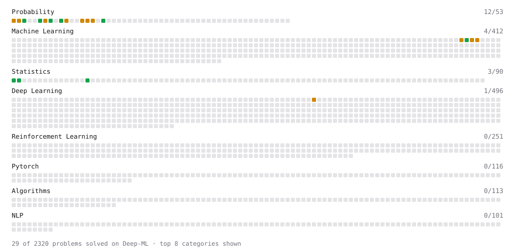

# Deep-ML

My machine learning practice from [Deep-ML](https://www.deep-ml.com). Every solution here was written by hand.

**Completed:** Calculus (9/9)

**30** solved · 30 problems · 0 labs · 0 math

[**Browse the interactive portfolio**](https://alb816.github.io/deep-ml/) to replay this filling in over time.

## Problems

| | Difficulty | Solved | |
| --- | --- | --- | --- |
| [Calculate Conditional Probability from Data](https://www.deep-ml.com/problems/168) | easy | 2026-09-19 | [solution](problems/0168-calculate-conditional-probability-from-data) |
| [Calculate Covariance Matrix](https://www.deep-ml.com/problems/10) | easy | 2026-09-21 | [solution](problems/0010-calculate-covariance-matrix) |
| [Derivative of a Polynomial](https://www.deep-ml.com/problems/116) | easy | 2026-09-19 | [solution](problems/0116-derivative-of-a-polynomial) |
| [Descriptive Statistics Calculator](https://www.deep-ml.com/problems/78) | easy | 2026-09-21 | [solution](problems/0078-descriptive-statistics-calculator) |
| [Expected Value and Variance of an n-Sided Die](https://www.deep-ml.com/problems/179) | easy | 2026-09-21 | [solution](problems/0179-expected-value-and-variance-of-an-n-sided-die) |
| [Generate Normal Samples and Compute Histogram Counts](https://www.deep-ml.com/problems/1130) | easy | 2026-09-25 | [solution](problems/1130-generate-normal-samples-and-compute-histogram-counts) |
| [Poisson Distribution Probability Calculator](https://www.deep-ml.com/problems/81) | easy | 2026-09-19 | [solution](problems/0081-poisson-distribution-probability-calculator) |
| [Sampling Distribution of the Mean](https://www.deep-ml.com/problems/181) | easy | 2026-11-18 | [solution](problems/0181-sampling-distribution-of-the-mean) |
| [Simulate Two-Dice Sum Distribution](https://www.deep-ml.com/problems/1139) | easy | 2026-09-21 | [solution](problems/1139-simulate-two-dice-sum-distribution) |
| [Taylor Series Approximation](https://www.deep-ml.com/problems/310) | easy | 2026-10-18 | [solution](problems/0310-taylor-series-approximation) |
| [Binomial Distribution Probability](https://www.deep-ml.com/problems/79) | medium | 2026-09-19 | [solution](problems/0079-binomial-distribution-probability) |
| [Birthday Problem Probability](https://www.deep-ml.com/problems/246) | medium | 2026-11-19 | [solution](problems/0246-birthday-problem-probability) |
| [Central Limit Theorem Simulation](https://www.deep-ml.com/problems/182) | medium | 2026-11-18 | [solution](problems/0182-central-limit-theorem-simulation) |
| [Chain Rule for Composite Functions](https://www.deep-ml.com/problems/214) | medium | 2026-09-28 | [solution](problems/0214-chain-rule-for-composite-functions) |
| [Chi-square Probability Distribution](https://www.deep-ml.com/problems/176) | medium | 2026-11-18 | [solution](problems/0176-chi-square-probability-distribution) |
| [Classify Critical Points Using Hessian Eigenvalues](https://www.deep-ml.com/problems/311) | medium | 2026-10-18 | [solution](problems/0311-classify-critical-points-using-hessian-eigenvalues) |
| [Compute Covariance from Joint Probability Mass Function](https://www.deep-ml.com/problems/243) | medium | 2026-11-19 | [solution](problems/0243-compute-covariance-from-joint-probability-mass-function) |
| [Compute the Hessian Matrix](https://www.deep-ml.com/problems/218) | medium | 2026-10-02 | [solution](problems/0218-compute-the-hessian-matrix) |
| [Derivative of Cross-Entropy Loss w.r.t. Logits](https://www.deep-ml.com/problems/220) | medium | 2026-09-30 | [solution](problems/0220-derivative-of-cross-entropy-loss-w-r-t-logits) |
| [Derivative of Softmax](https://www.deep-ml.com/problems/219) | medium | 2026-09-30 | [solution](problems/0219-derivative-of-softmax) |
| [Find Captain Redbeard's Hidden Treasure](https://www.deep-ml.com/problems/127) | medium | 2026-09-17 | [solution](problems/0127-find-captain-redbeard-s-hidden-treasure) |
| [Hypergeometric Distribution PMF](https://www.deep-ml.com/problems/245) | medium | 2026-11-18 | [solution](problems/0245-hypergeometric-distribution-pmf) |
| [Jacobian Matrix Calculation](https://www.deep-ml.com/problems/202) | medium | 2026-09-29 | [solution](problems/0202-jacobian-matrix-calculation) |
| [Negative Binomial Distribution Probability](https://www.deep-ml.com/problems/247) | medium | 2026-11-19 | [solution](problems/0247-negative-binomial-distribution-probability) |
| [Newton's Method for Optimization](https://www.deep-ml.com/problems/221) | medium | 2026-09-29 | [solution](problems/0221-newton-s-method-for-optimization) |
| [Normal Distribution PDF Calculator](https://www.deep-ml.com/problems/80) | medium | 2026-11-18 | [solution](problems/0080-normal-distribution-pdf-calculator) |
| [Numerical Gradient Checking](https://www.deep-ml.com/problems/313) | medium | 2026-10-18 | [solution](problems/0313-numerical-gradient-checking) |
| [Partial Derivatives of Multivariable Functions](https://www.deep-ml.com/problems/215) | medium | 2026-09-27 | [solution](problems/0215-partial-derivatives-of-multivariable-functions) |
| [Product Rule for Derivatives](https://www.deep-ml.com/problems/309) | medium | 2026-09-26 | [solution](problems/0309-product-rule-for-derivatives) |
| [Quotient Rule for Derivatives](https://www.deep-ml.com/problems/312) | medium | 2026-09-18 | [solution](problems/0312-quotient-rule-for-derivatives) |

---

_This file is regenerated by Deep-ML on every push._
